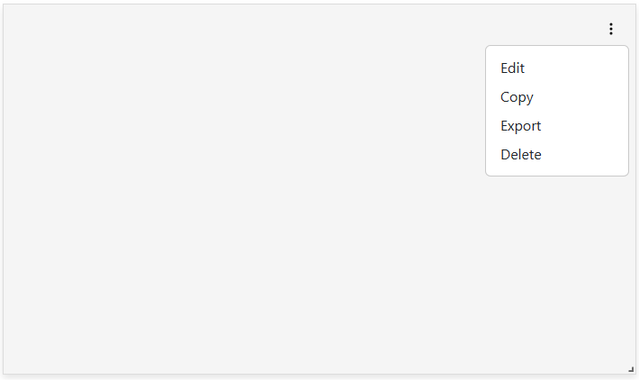

.. _dashboard_editing:

.. |dashboard_edit_button| image:: ../images/dashboard_edit_button.png
   :scale: 50%

.. |dashboard_add_item_button| image:: ../images/dashboard_add_item_button.png
   :scale: 50%

Editing Dashboards
==================

Users can edit dashboards they own or have editor/admin access to. After selecting a dashboard, click the |dashboard_edit_button| in the app header to enter edit mode. In edit mode, you can:

- Add, move, resize, or delete dashboard items
- Add and rename tabs to organize content
- Use the context menu on each item to edit, copy, delete, or export visualizations
- Save or revert changes

.. image:: ../images/dashboard_edit_mode.png
   :align: center

|

Tabs
----

Tabs help organize dashboard content. Click the plus sign at the top to add a tab. Rename tabs by clicking their name. Tabs can reference information from other tabs.

.. image:: ../images/add_tabs.png
   :align: center
   :width: 500px

|

Adding Dashboard Items
----------------------

To add a new dashboard item, click the "Add Dashboard Item" (|dashboard_add_item_button|) button in the header. A new item appears in the top left corner. Move items by dragging, and resize using the handle in the bottom right corner.

.. image:: ../images/add_dashboard_item.png
   :align: center

.. image:: ../images/add_dashboard_item_new.png
   :align: center

|

Dashboard Item Context Menu
---------------------------

Each dashboard item has a context menu (top right) for editing, copying, deleting, or exporting the visualization.

|

Secrets
-------

Some visualizations need a secret, such as an API key or a password, to read their data. A secret has its own field in the dashboard item's settings, or on a map layer's Source tab. The field is write-only: you can set, replace or clear a secret, but once entered it is never shown again, not even to you.

- **Set**: type the secret and click **Apply**, press Enter, or move to another field. The field then reads "New secret entered. It is saved when you save the dashboard." The preview in the editor uses the new secret right away.
- **Replace**: on a field that reads **Secret set**, click **Replace** and type the new secret.
- **Clear**: click **Clear**. The secret is removed when you save the dashboard.
- **Undo**: before you save, undo a secret you entered or cleared.

A secret you enter or clear goes with the editor's other settings. **Close** in the item's settings or the layer editor, or **Cancel** in the popup layout editor, discards it along with them. **Save** in the item's settings, or **Create** in the layer editor, keeps it until you save the dashboard: a secret is saved only when you save the dashboard with **Save Changes**. **Cancel Changes** discards every secret entered or cleared since the last save. Saving an item or a layer with a different visualization removes the secret entered for the old one.

Until a secret is entered, the item shows editors "This tile needs a secret. Enter it in the tile's settings." Viewers see "This tile needs a secret that hasn't been set up yet." If an item shows "The secret saved for this tile can't be read. Enter it again in the tile's settings.", enter the secret again.

Secrets are never copied. Copying a dashboard, copying a dashboard item, exporting a dashboard or an item, and importing one all leave the secret fields empty. An editor of the new dashboard or item enters the secrets again.

.. warning::

   Think about who can use a secret before you enter it:

   - Anyone who can view a public dashboard uses its secrets each time they view it. If the secret is your API key, every visitor's views count against your account's limits or billing.
   - Anyone with edit rights on the dashboard can replace or clear its secrets, and can run its items with them, other settings changed included.
   - Do not connect an item's address, URL or host setting to any variable input, whether a text box, a dropdown, a slider or a checkbox. A viewer can send any value for a connected setting, not only the input's own options, so they could send an address of their own, and the item would send its secret there.
